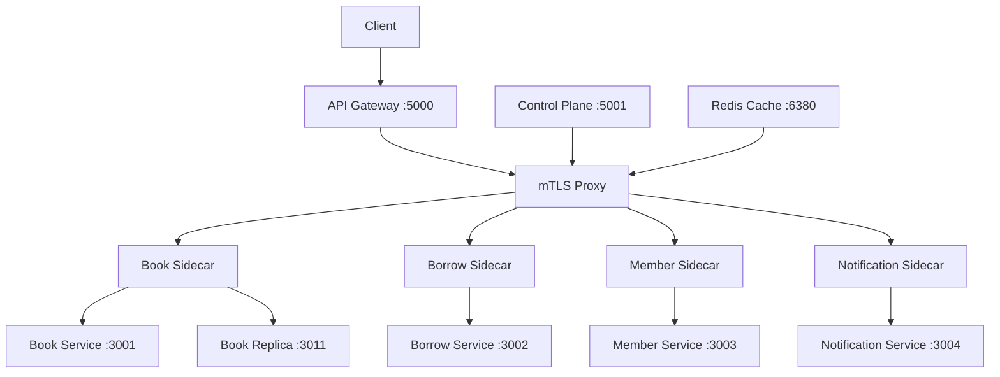

# Multi-Cloud Service Mesh – Data Plane Sidecar

A multi-cloud service communication system that demonstrates secure service-to-service communication, mutual TLS (mTLS), traffic routing, load balancing, service discovery, and Redis caching.

## Project Overview

This project implements a Multi-Cloud Service Mesh using the **Sidecar Data Plane Architecture**.

It provides secure communication between distributed backend services through sidecar proxies. An API Gateway handles client requests, while the Control Plane manages service configuration and traffic weights.

The project demonstrates how services deployed across different cloud environments can communicate securely and efficiently.

## Architecture



## Technologies Used

- **Node.js** – Backend services and API Gateway
- **Express.js** – REST API development
- **Redis** – Caching
- **PostgreSQL** – Database
- **Docker** – Containerization
- **PowerShell** – Testing and automation
- **TLS / mTLS** – Secure service communication
- **Git and GitHub** – Version control

## Main Components

### 1. API Gateway
- Acts as the single entry point for client requests.
- Routes requests to the appropriate services.
- Implements token-based authentication.
- Communicates securely with the mTLS proxy.

### 2. Sidecar Data Plane
- Each backend service has an associated sidecar.
- Handles service-to-service communication.
- Supports secure communication using mutual TLS.
- Forwards requests to backend services.

### 3. Control Plane
- Manages service configurations.
- Controls traffic weights.
- Supports weighted routing between the primary Book service and its replica.

### 4. Redis Caching
- Caches eligible GET requests.
- Supports cache MISS and HIT operations.
- Invalidates cached data after Book write operations.

### 5. Backend Services

| Service | Port |
|---|---:|
| Book Service | 3001 |
| Borrow Service | 3002 |
| Member Service | 3003 |
| Notification Service | 3004 |
| Book Replica | 3011 |

## Port Configuration

| Component | Port |
|---|---:|
| API Gateway | 5000 |
| Control Plane | 5001 |
| Book Proxy | 4101 |
| Borrow Proxy | 4102 |
| Member Proxy | 4103 |
| Notification Proxy | 4104 |
| Book Sidecar | 4001 |
| Borrow Sidecar | 4002 |
| Member Sidecar | 4003 |
| Notification Sidecar | 4004 |
| Book Replica Sidecar | 4005 |
| mTLS Sidecar Listeners | 4401–4405 |
| Redis | 6380 (host) |

## Key Features

- API Gateway-based request routing.
- Token-based API authentication.
- Mutual TLS certificate-based authentication.
- Secure communication between sidecars and proxies.
- Weighted traffic distribution (70:30) between Book primary and replica.
- Dynamic traffic-weight updates through the Control Plane.
- Redis cache HIT and MISS handling.
- Cache invalidation after Book write operations.
- Health monitoring of backend services.

## API Endpoints

| Method | Endpoint | Description |
|---|---|---|
| GET | `/health` | API Gateway health |
| GET | `/api/books` | Retrieve books |
| GET | `/api/borrow` | Retrieve borrow records |
| GET | `/api/members` | Retrieve members |
| GET | `/api/notifications` | Retrieve notifications |

Protected API requests require the authorization header:

```http
Authorization: Bearer mesh-demo-token
```

## Testing and Verification

The following local tests have been successfully performed:

| Test Case | Result |
|---|---|
| Backend service health checks | PASS |
| API Gateway integration | PASS |
| Authentication validation | PASS |
| mTLS certificate verification | PASS |
| Weighted traffic routing (70:30) | PASS |
| Control Plane weight updates | PASS |
| Redis cache MISS and HIT | PASS |
| Redis cache invalidation | PASS |

### Sample Test Results

**API Gateway Integration**
- Book API – HTTP 200
- Borrow API – HTTP 200
- Member API – HTTP 200
- Notification API – HTTP 200

**Redis Cache**
- First request – MISS
- Second request – HIT

**Authentication**
- Invalid token – HTTP 401
- Missing token – HTTP 401

**Weighted Routing**
- Primary Book service – 70%
- Book replica – 30%

These results are from local testing.

## Project Structure

```text
multi-cloud-service-mesh/
│
├── api-gateway/
├── control-plane/
├── mtls-proxy/
├── services/
│   ├── book-service/
│   ├── book-service-replica/
│   ├── borrow-service/
│   ├── member-service/
│   └── notification-service/
│
├── sidecars/
│   ├── book-sidecar/
│   ├── book-replica-sidecar/
│   ├── borrow-sidecar/
│   ├── member-sidecar/
│   └── notification-sidecar/
│
└── tests/
    ├── 01_environment/
    ├── 02_backend_services/
    ├── 03_api_gateway/
    ├── 04_sidecar_mtls/
    ├── 05_traffic_routing/
    ├── 06_redis/
    ├── results/
    └── screenshots/
```

## Future Scope

- Deploy services across AWS and Google Cloud Platform (GCP).
- Configure cross-cloud networking.
- Implement cloud-based service discovery.
- Enable cross-cloud mTLS communication.
- Implement cloud-level traffic splitting and failover.
- Perform end-to-end testing in the deployed multi-cloud environment.

## Project Status

**Local implementation and testing completed.**

AWS and GCP deployment and cross-cloud verification are pending.

## Author

**Khushboo Talreja**

GitHub: [khushitalreja26](https://github.com/khushitalreja26)

Project Repository: [SD-MINI-PROJECT](https://github.com/khushitalreja26/SD-MINI-PROJECT)
